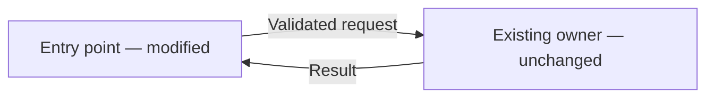
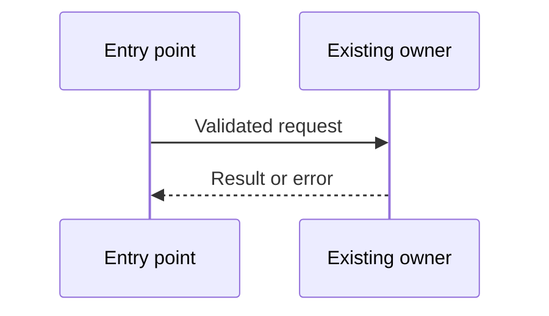

# How We Are Going to Build It

Understand how the relevant codebase actually works before proposing changes. Then explain the smallest durable design in plain language: what changes, what stays the same, what each part does, and how the parts communicate. Reuse healthy patterns, but do not reproduce accidental coupling or duplication merely for consistency. Correct demonstrated design problems the change would otherwise spread; introduce a new abstraction only when repository evidence or concrete requirements justify it.

This skill designs; it does not implement.

Save the final proposal after the pride gate at:

```text
.features/{feature}/how-we-are-going-to-build.md
```

Use the existing feature folder when one exists. If the feature name is unclear, ask for a slug before writing the file.

## Method

1. **Clarify the requirement**
   Read the existing feature specification when available. Ask only about gaps that materially affect the design.
   - Goal and observable result
   - Entry boundary
   - Invariants and non-goals
   - Decisions that must be answered before implementation

2. **Build a deep understanding of the relevant codebase**
   Start with repository guidance and architecture docs, then search for the entry points and analogous behavior. Read the actual implementation and its callers, dependencies, and tests; search results and documentation alone are not proof.

   Trace a representative request or operation end to end: input, validation, decisions, state changes, side effects, and returned result. Follow the important failure paths too. Identify who owns each rule and state, which contracts connect the parts, and which consumers could be affected by a change. Inspect persistence and external integrations where relevant.

   Before designing, explain the current flow in plain language with concrete `path:Symbol` anchors. Distinguish observed behavior from assumptions and unresolved questions. If a gap could change the recommendation, inspect further or ask rather than guessing. Depth means understanding the relevant path and its consequences, not reading every file.

   Classify findings as healthy patterns, accidental duplication or coupling, or justified missing boundaries. Do not manufacture a problem to fill a category.

3. **Evaluate design pressure and sustainability**
   Focus on the touched path and nearby problems the implementation would propagate—not a codebase-wide cleanup.
   - What would a straightforward implementation copy or worsen? Cite duplication, scattered decisions, unclear ownership, or inconsistent failure behavior.
   - Do similar cases share a contract and need to change together? Similar-looking code alone does not justify consolidation.
   - Who should own the rule and state? Prefer an existing owner when it fits.
   - Choose between reuse, a local correction, a focused refactor, and a new abstraction. A direct implementation with no new abstraction is valid.
   - Explain what proves the choice helps: fewer independently maintained decisions, invalid states prevented, or behavior tested at a stable boundary. State when no corrective change is warranted.

   Describe variation, dependency boundaries, and relevant failure behavior. Consider invalid input, partial failure, retry, timeout, duplicate work, and recovery only where applicable.

   Use language-native mechanisms and local conventions first. Name a GoF, Fowler, Game Programming Patterns, Head First, or Refactoring pattern only when it explains a real pressure. Never add a pattern for its own sake.

4. **Decompose and explain one recommended design**
   Explain the proposal progressively, from the whole system to its parts:
   - First give the high-level picture: the intended behavior, the major components, what each does, and how they cooperate to produce the result. Explain the change and why it fits the current codebase without starting with file names, signatures, or implementation details.
   - Then walk through the main operation across those components.
   - Finally expand each component into the responsibilities, contracts, state, decisions, dependencies, and relevant failure handling needed to implement it. Split a component into smaller parts only when that clarifies the design.

   Use concrete names and plain language; explain necessary technical terms. Keep names consistent across levels and connect each detail to the component it belongs to. The reader should understand the high-level proposal on its own, with deeper sections answering how it will work.

   Break the solution into parts by responsibility. Parts may be existing functions or modules; decomposition does not require new services, classes, or abstractions. For each part, state:
   - its responsibility and ownership of rules or state;
   - its existing or proposed location;
   - whether it is unchanged, modified, or new;
   - its inputs, outputs, and dependencies.

   Explain how the parts communicate: who initiates each interaction, what data crosses the boundary, whether it is a call, event, or other mechanism, and how results and relevant errors return. Walk through the main operation in order and describe the important failure behavior. Make the contracts explicit rather than saying only that parts “integrate.”

   Use Mermaid diagrams to explain the proposal:
   - a `flowchart` for the parts and their connections, clearly marking unchanged, modified, and new parts and labeling arrows with the interaction or data;
   - a `sequenceDiagram` for the main operation, showing ordering, responses, and important failure branches where applicable.

   Keep diagrams small and consistent with the prose. Begin with a high-level component diagram; add component-level diagrams only where they explain internal behavior that the overview cannot. Use the same part names throughout. Show current versus proposed flow when that distinction explains the change; do not invent components for diagram symmetry. Diagrams complement the explanation, not replace it.

   Include the sustainability decision, relevant persistence/integration consequences, tests proving contracts and failure behavior, and migration or rollout only when existing behavior changes. Use short signatures or pseudocode only to clarify a contract. Do not dump implementation code.

5. **Compare only consequential alternatives**
   Give up to three real options. For each, state fit with current code, future leverage, complexity/risk, and when it is appropriate. Be opinionated about the recommendation.

6. **End with the build order**
   List the smallest sequence of applicable changes and checks. Attach an observable proof to each step. When establishing a non-obvious boundary, include recording its ownership rule and rationale in the relevant architecture document and testing its observable behavior so future agents do not repeat the mistake.

## Output

````markdown
# How We Are Going to Build It

## Recommendation
{design decision and why it fits this codebase}

## Contract
- Goal:
- Boundary:
- Invariants:
- Non-goals:
- Decisions needed:

## How the code works today
{plain-language end-to-end flow, ownership, and relevant constraints}
- Evidence: `path/to/file:Symbol`
- Healthy patterns and demonstrated problems:
- Assumptions or unresolved questions:

## Proposed behavior at a high level
{explain the intended result, major components, each component's role, and how they cooperate; leave implementation details for the component sections}

### Components and communication
{explain the connections and label each component's change status in the diagram}

{replace the example with the actual proposed parts and interactions}

### Operation walkthrough
{numbered plain-language steps across the major components, including relevant errors and recovery}

{replace the example with the actual operation; include important failure branches}

## Component details
{repeat for each major component, using the same names as the overview}

### {Component name}
- Responsibility and state ownership:
- Location and status: {existing/proposed path; unchanged/modified/new}
- Inputs, outputs, and communication contracts:
- Internal behavior: {rules and steps; smaller parts only where useful}
- Dependencies:
- Failure and recovery:
{add a focused Mermaid diagram only if it clarifies the internal behavior}

## Verification
{checks proving contracts, behavior, and relevant failures; rollout when applicable}

## Sustainability
- Existing design pressure: {concrete evidence, or none found}
- Risk of following the current pattern:
- Decision: {reuse | local correction | focused refactor | new abstraction}
- Why this is sufficient:
- Scope boundary: {what remains unchanged}
- Proof: {test or observable structural improvement}

## Alternatives
{only real consequential alternatives and trade-offs}

## Build order
1. {change} — proof: {observable result}

## Approval boundary
{API, schema, auth, persistence, infrastructure, dependency, or cross-cutting decisions needing approval}
````

## Pride gate

Before presenting or saving the proposal, run `are-you-proud` as a proposal review: assess depth of codebase understanding, repository evidence, feasibility, simplicity, trade-offs, and planned verification. Check that the proposal explains the whole system before component details, that responsibilities and communication are clear at both levels, and that diagrams agree with the prose and contracts. Do not imply implementation checks have run. Resolve blocking findings and rerun the review until the verdict is **Proud**; optional notes may remain. If missing evidence or a decision requiring the user's authority blocks the proposal, report the blocker rather than looping or claiming certainty. Save only the final Proud proposal to `.features/{feature}/how-we-are-going-to-build.md`.

Keep it short enough for an architecture discussion. Separate evidence, assumptions, recommendations, and decisions. Do not claim repository behavior without an anchor. Do not implement until explicitly asked.
