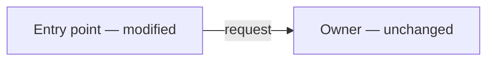
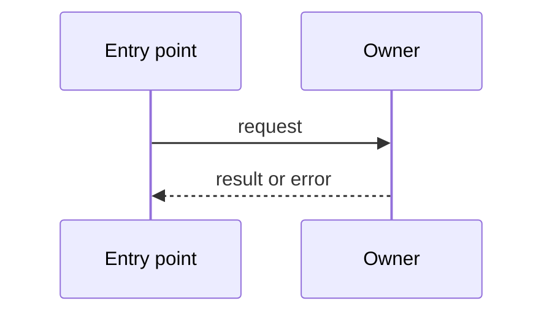

# Plan

Build a shared, high-level understanding of what we are building and how, before writing tasks or code. The plan is the source for `simple-tasks`. It does not implement anything.

Save it at `.features/{feature}/plan.md`. Ask for a feature slug if it is unclear. A plan always ends with an Oracle review that uses the `are-you-proud` skill: follow [Review with are-you-proud](#review-with-are-you-proud) before you present it.

## Method

1. **Understand the request.** State the problem, who has it, the observable outcome, and what is out of scope. Ask only about gaps that change the plan.
2. **Describe the behavior.** Write Given / When / Then scenarios for the main path and for failures and recovery that matter (invalid input, permission, empty, conflict, offline). Name the actors, concepts, and states once, reusing the product's existing terms.
3. **Learn how the code works today.** Read the entry points, the code they call, and their tests. Trace one representative operation end to end, including a failure path. Cite `path:Symbol` for every claim about current behavior. Separate what you observed from what you assume.
4. **Judge whether the code is fit for the change.** Ask whether the change would be easy where it has to go. Warning signs: one behavior needs edits in several places; logic duplicated in copies you would all have to change; no tests or seam around the code you will touch; the change belongs in a different layer than the code puts it; names that hide what the code is responsible for. For each sign, decide one outcome, with `path:Symbol` evidence:
   - **Fit:** build on it.
   - **Prepare:** a behavior-preserving change the feature needs first, such as extracting duplicated logic or pinning untested code with tests. It is the first slice of the build order, proved by tests written on the base that pass unchanged after.
   - **Note:** a problem this change does not need fixed; list it, do not fix it.

   Prepare only what makes this change easier or keeps it from copying the problem; anything else is a note.
   "Make the change easy, then make the easy change." Following an unhealthy pattern spreads it; do not mirror it.
5. **Design the change.** Recommend one design that fits the current code. Explain the parts, what each owns, and how they talk to each other, from the whole system down to each part. Mark each part unchanged, modified, or new. Build on the result of the fit check: reuse what is fit, and design on top of the prepared code. Add an abstraction only when evidence requires it.
6. **Compare real alternatives.** At most three, only when the choice matters: fit, risk, and when each would be better.
7. **Plan the verification.** For each outcome, say how we will prove it at the real boundary: test, browser workflow, API call, or script. Each task's feedback loop turns this into concrete checks.
8. **Order the build.** Split the work into small vertical slices, each with an observable result; a Prepare slice comes first, and its observable result is unchanged behavior. Each slice becomes one or more tasks.
9. **List the decisions.** Anything the user must decide (product behavior, API, schema, auth, persistence, rollout, new dependency) goes in Decisions needed, with the options and why it matters. Do not decide these yourself.

For UI work, add one proposed mockup, saved beside the plan and labeled **Proposed — not approved**. The plan must make sense without it.

## Plan shape

````markdown
# Plan: {feature}

## Decisions needed
- {question} — options: {a | b}; why it matters: {consequence}; owner: {user | team}

## Outcome
{problem, who has it, observable result, out of scope}

## Behavior
### Scenario: {outcome}
- Given ...
- When ...
- Then ...

## How the code works today
{end-to-end flow in plain language}
- Evidence: `path:Symbol`
- Assumptions:

## Fit for the change
- {warning sign} at `path:Symbol` → fit | prepare | note: {why}

## Design
{recommendation and why it fits this code}





### {Part}
- Owns:
- Location and status: `{path}` — unchanged | modified | new
- Talks to: {who, what crosses, how errors return}

## Alternatives
- {option}: {fit, risk, when it would be better}

## Verification
- {outcome} → {test | browser | API | script}: {what we will observe}

## Build order
1. {Prepare slice, when the fit check found one} — observable result: behavior unchanged, pinned by {tests}
2. {slice} — observable result: {result}
````

Omit sections that add nothing: a small change may need only Outcome, Behavior, Design, Verification, and Build order. Keep Fit for the change whenever it found anything other than fit. Use diagrams only when they explain something the prose does not, and keep their names identical to the prose.

## Review with are-you-proud

Before presenting the plan, ask the Oracle, with the foreground `subagent` tool and agent `oracle`, to review it with `are-you-proud`. Pass the plan path, the user's request, and the previous round's findings. If you have no `subagent` tool or the Oracle is unavailable, read the `are-you-proud` skill and review it yourself, and report that the review was not independent. For a plan, the review looks for:

- contradictions between sections, such as a scenario the design cannot produce or a build step with no outcome;
- ambiguous or undefined terms, owners, and boundaries;
- claims about current code without evidence, or that the cited code does not support: open the cited `path:Symbol` and check;
- a design that fights the existing structure or copies a problem the fit check should have caught;
- outcomes that cannot be verified as written;
- design or Prepare work larger than the outcome needs.

Iterate until proud, as `are-you-proud` defines: fix every must-fix and should-fix finding, then request another round; a round that led to a fix is never the last. Stop when a round has no must-fix and no should-fix findings. A question only the user can answer goes into Decisions needed; it is not a finding, and it does not delay the review. When you present the plan, give the final verdict, the number of rounds, and the reviewer: the Oracle, or you when it was unavailable.

## After approval

The user's approval of the plan authorizes the work it describes, except anything still in Decisions needed. Record decisions with lasting architectural value in the relevant ADR (`docs/adrs/architecture.md`, `api.md`, or `web.md`). Then create tasks from the build order with `simple-tasks`.
