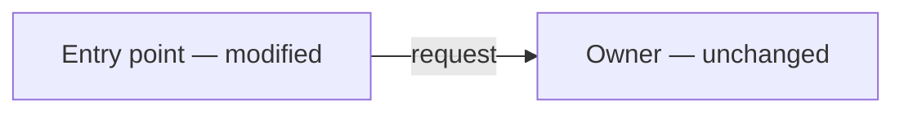
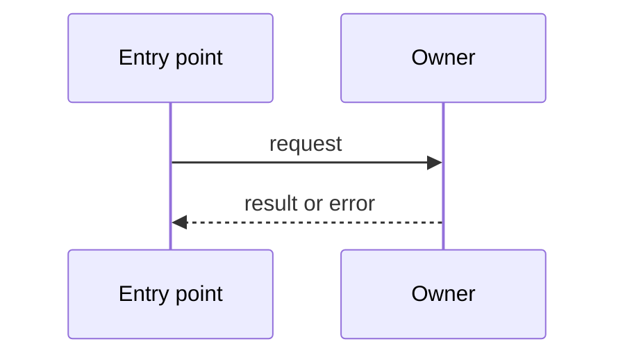

# Plan

Build a shared, high-level understanding of what we are building and how, before writing tasks or code. The plan is the source for `simple-tasks`. It does not implement anything.

Save it at `.features/{feature}/plan.md`. Ask for a feature slug if it is unclear.

## Method

1. **Understand the request.** State the problem, who has it, the observable outcome, and what is out of scope. Ask only about gaps that change the plan.
2. **Describe the behavior.** Write Given / When / Then scenarios for the main path and for failures and recovery that matter (invalid input, permission, empty, conflict, offline). Name the actors, concepts, and states once, reusing the product's existing terms.
3. **Learn how the code works today.** Read the entry points, the code they call, and their tests. Trace one representative operation end to end, including a failure path. Cite `path:Symbol` for every claim about current behavior. Separate what you observed from what you assume.
4. **Design the change.** Recommend one design that fits the current code. Explain the parts, what each owns, and how they talk to each other, from the whole system down to each part. Mark each part unchanged, modified, or new. Reuse healthy patterns; fix a nearby problem only if the change would otherwise spread it. Add an abstraction only when evidence requires it.
5. **Compare real alternatives.** At most three, only when the choice matters: fit, risk, and when each would be better.
6. **Plan the verification.** For each outcome, say how we will prove it at the real boundary: test, browser workflow, API call, or script. Each task's feedback loop turns this into concrete checks.
7. **Order the build.** Split the work into small vertical slices, each with an observable result. Each slice becomes one or more tasks.
8. **List the decisions.** Anything the user must decide (product behavior, API, schema, auth, persistence, rollout, new dependency) goes in Decisions needed, with the options and why it matters. Do not decide these yourself.

For UI work, add one proposed mockup, saved beside the plan and labeled **Proposed — not approved**. The plan must make sense without it.

## Plan shape

````markdown
# Plan: {feature}

## Decisions needed
- {question} — options: {a | b}; why it matters: {consequence}; owner: {user | team}

## Outcome
{problem, who has it, observable result, out of scope}

## Behavior
### Scenario: {outcome}
- Given ...
- When ...
- Then ...

## How the code works today
{end-to-end flow in plain language}
- Evidence: `path:Symbol`
- Assumptions:

## Design
{recommendation and why it fits this code}





### {Part}
- Owns:
- Location and status: `{path}` — unchanged | modified | new
- Talks to: {who, what crosses, how errors return}

## Alternatives
- {option}: {fit, risk, when it would be better}

## Verification
- {outcome} → {test | browser | API | script}: {what we will observe}

## Build order
1. {slice} — observable result: {result}
````

Omit sections that add nothing: a small change may need only Outcome, Behavior, Design, Verification, and Build order. Use diagrams only when they explain something the prose does not, and keep their names identical to the prose.

## Review with are-you-proud

Before presenting the plan, review it with `are-you-proud`. For a plan, it looks for:

- contradictions between sections, such as a scenario the design cannot produce or a build step with no outcome;
- ambiguous or undefined terms, owners, and boundaries;
- claims about current code without evidence;
- outcomes that cannot be verified as written;
- design that is larger than the outcome needs.

Iterate until proud, as `are-you-proud` defines: fix and review again until a round has no must-fix and no should-fix findings. A question only the user can answer goes into Decisions needed; it is not a finding.

## After approval

The user's approval of the plan authorizes the work it describes, except anything still in Decisions needed. Record decisions with lasting architectural value in the relevant ADR (`docs/adrs/architecture.md`, `api.md`, or `web.md`). Then create tasks from the build order with `simple-tasks`.
